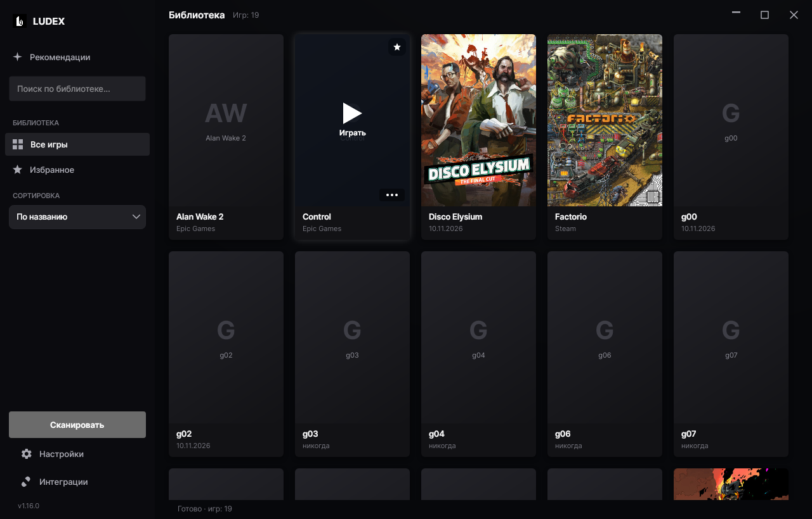
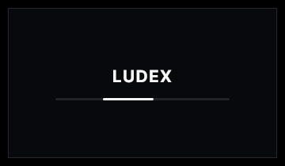
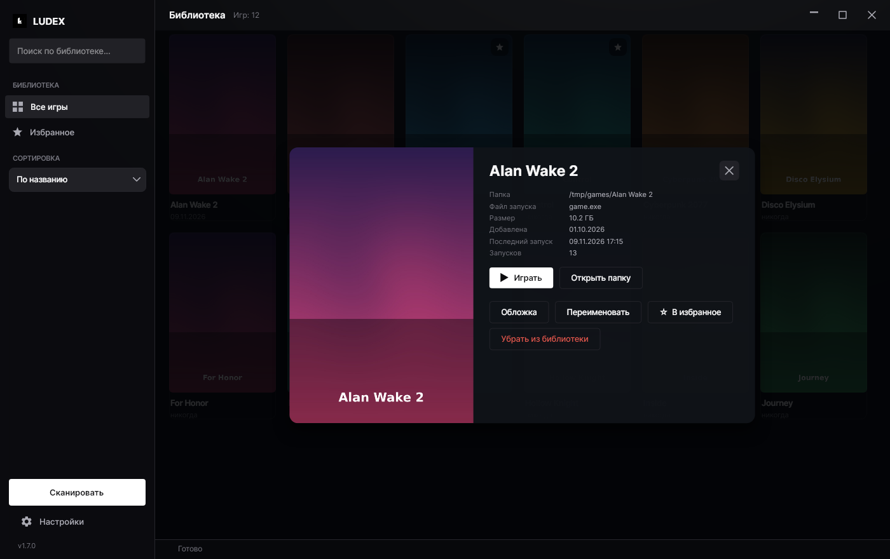
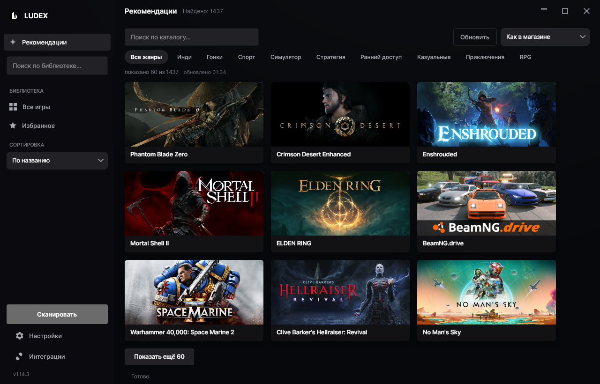
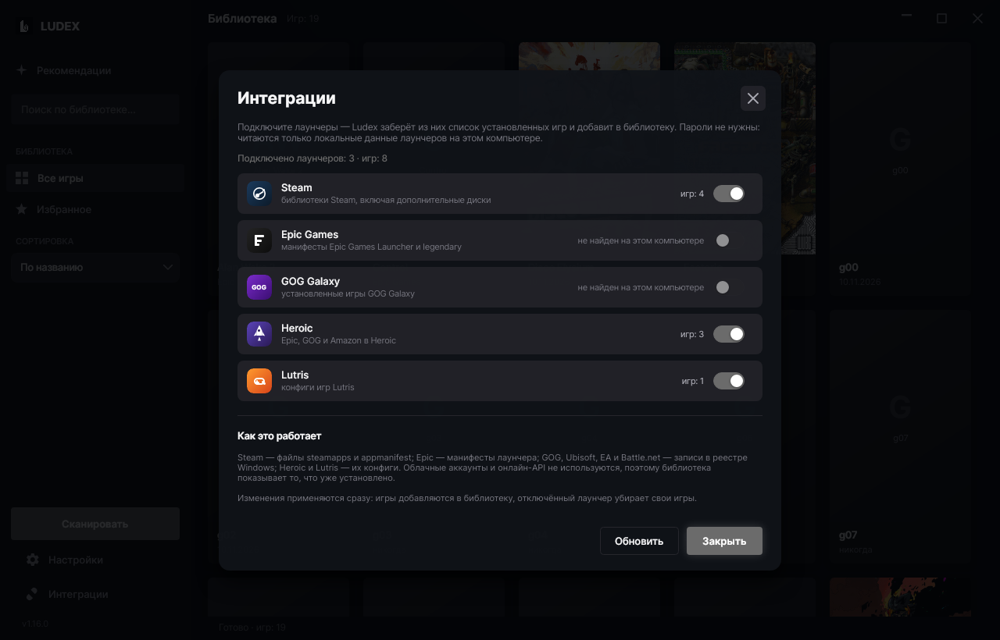
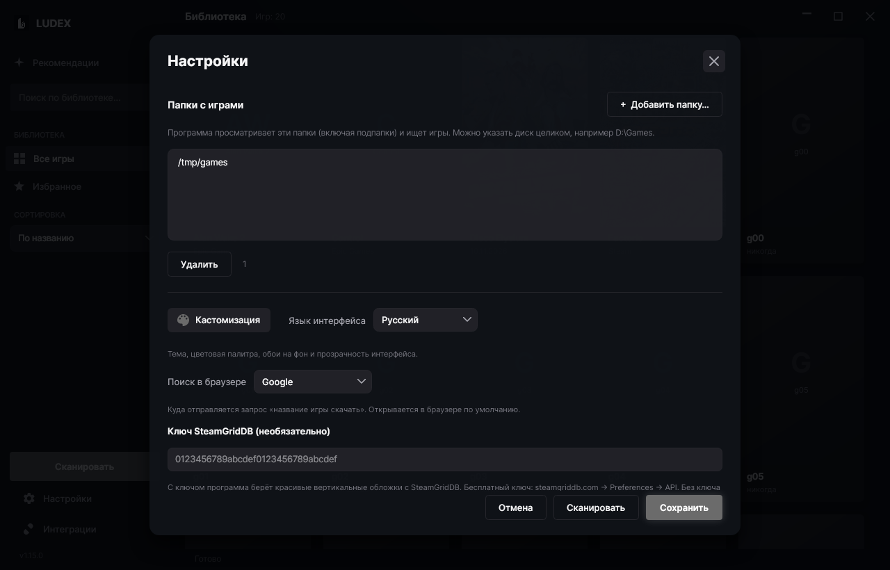
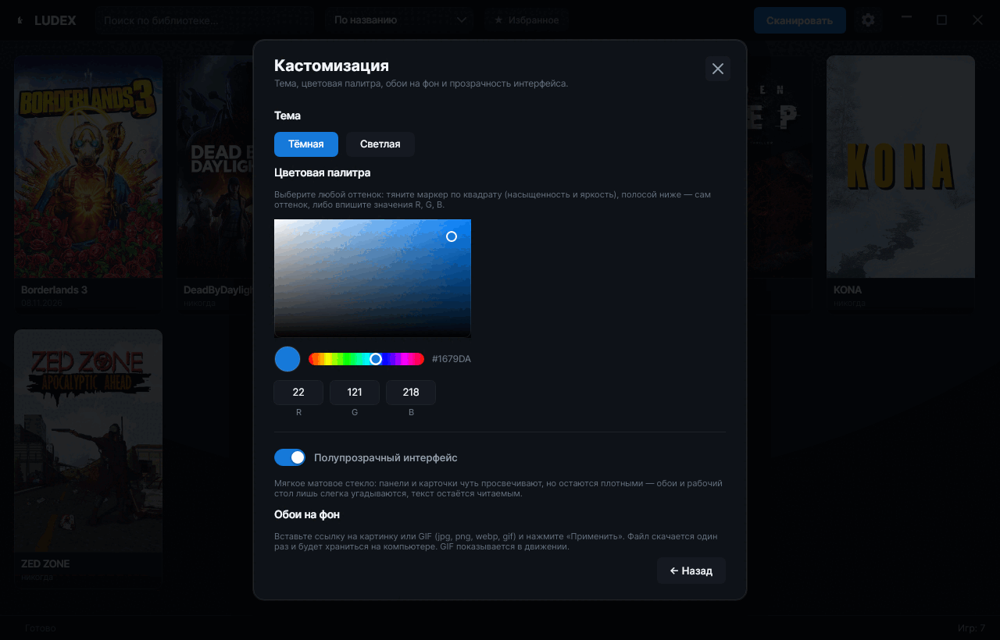
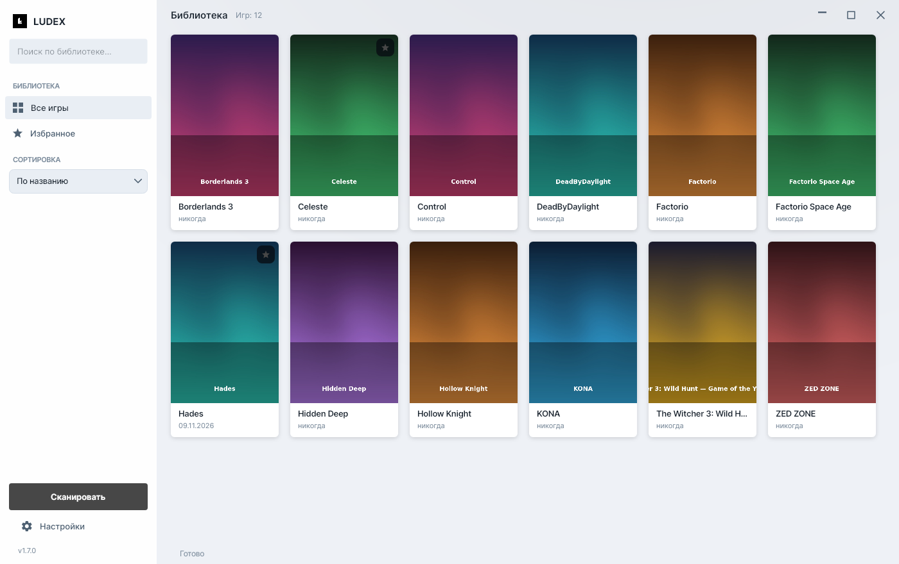

<div align="center">


# Ludex

**A Steam-like local game library — for the games already sitting on your disk.**

The app walks the folders you point it at, finds the games itself, cleans up their titles
and fetches artwork. No accounts, no launcher, no cloud — just your files and a tidy interface.

[](#windows-1011-x64)
[](#linux-x64)
[](#building-from-source)
[](https://avaloniaui.net)
[](CHANGELOG.md)
[](LICENSE)
[](https://ludex-one.vercel.app/?lang=en)



**Русская версия:** [README.md](README.md)

</div>

---

## Support the author

Ludex is free: no accounts, no subscription, no ads. If the app saved you some time,
you can say thanks via **DonationAlerts** — one-time or recurring, card or local payment methods:

**[donationalerts.com/r/c04hbiu](https://www.donationalerts.com/r/c04hbiu)** — the “C04HbIU” page

[](https://www.donationalerts.com/r/c04hbiu)

## Features

- **Games are found for you.** Point at a folder (or a whole drive) → Ludex finds the `.exe` files,
  skips installers and `vcredist`, picks the real launcher and strips junk from the title such as
  `[FitGirl Repack]`, `v1.6.8`, `_RUNE` or `MULTi12`.
- **Artwork comes by itself.** It searches the Steam catalogue with no keys and no sign-up;
  a SteamGridDB key is optional and unlocks portrait covers and community art. A local image works too.
- **One-click launch.** Click a cover to start the game (optionally “as administrator”);
  click the caption to open the game panel with the folder, size and launch statistics.
- **Search, sorting, favourites.** By title / date added / last played, a “★ Favourites” filter,
  and search across titles, folders and Steam names.
- **Customisation.** Dark and light themes, any accent colour (a saturation/brightness square,
  a hue strip and R/G/B), translucent “glass” panels and wallpapers by link — a still image or an
  animated GIF.
- **Catalogue of single-player games.** The “Catalogue” tab lists games you can play offline:
  action, adventure, indie, RPG, strategy, simulation, casual, racing, sports and early access.
  Online shooters and MMOs, free live services and tools such as crosshair apps are filtered out:
  the catalogue is built from the store search with the “has single-player” filter and cached.
- **Catalogue filters.** A single **“Filters”** button opens a panel with ready-made picks
  (“Co-op for the evening”, “Horror & zombies”, “2000s classics”…), genres as tiles, themes
  (open world, survival, post-apocalyptic, roguelike and four dozen more), release year,
  description length and two toggles — “only with a description” and “only games not in my
  library”. The sort switch sits next to the button.
- **Your favourite categories.** Above the catalogue you get tiles for the genres and themes
  that appear most often in your own library — one click filters by that category.
- **Fast start.** A small loading screen is shown while the catalogue and your library are prepared
  underneath, so the tab opens instantly, already with covers. When loading finishes, the interface
  unfolds from the centre — one smooth motion instead of a window popping up.
- **Game card.** Cover, title, developer and publisher, genres, a short description and a
  **“Find in browser”** button — it opens your default browser with a “<game name> download” query
  (Google, Yandex or DuckDuckGo, selectable in settings). There are no prices and no links to
  third-party releases inside the app.
- **Uninstall from the app.** From the card menu: a discovered uninstaller runs first; if there is
  none, the game folder is deleted entirely (with confirmation and protection against dangerous paths).
- **Russian and English UI.**
- **Portable.** A self-contained build — no need to install .NET. It also works as a per-user
  installer without administrator rights.

## Screenshots

| Loading screen (separate window) | Library |
|---|---|
|  |  |

| Game panel | Catalogue |
|---|---|
|  |  |

| Launcher integrations | Settings |
|---|---|
|  |  |

| Customisation | Light theme |
|---|---|
|  |  |

## Website

The project landing page (same text, screenshots and download buttons) —
**[ludex-one.vercel.app](https://ludex-one.vercel.app)** (Russian by default, English at
[ludex-one.vercel.app/?lang=en](https://ludex-one.vercel.app/?lang=en)). The source lives in
[`site/`](site) and deploys to Vercel automatically on every push to `main`.

The site shows a download counter built from two sources:

- **GitHub** — `download_count` of release assets via
  [`site/api/downloads.js`](site/api/downloads.js), cached at the edge for 10 minutes (to stay
  inside the 60 requests/hour limit);
- **clicks on the site itself** — [`site/api/go.js`](site/api/go.js) records the click in
  Upstash Redis and immediately answers with a 302 to the newest release asset (the URL is stored
  in Redis, so buttons don’t depend on the version written into the markup);
  [`site/api/clicks.js`](site/api/clicks.js) reads the counters with a 30-second cache.

On the page it looks like `↓ 128 downloads on GitHub · 34 clicks from the site`, plus per-file
clicks on each button. Redis is optional: without environment variables (or if it fails) the site
shows GitHub statistics only, and if those fail as well the counter is simply hidden while the page
keeps working.

## Installation

The same application is built for two systems. All files live on the
[Releases](https://github.com/dosherrk/ludex/releases) page; the project site picks the right
buttons for your system automatically.

### Windows 10/11 (x64)

**Option 1 — installer (recommended).** `Ludex-Setup-1.21.0.exe` → choose the language → “Next”.
It installs into `%LOCALAPPDATA%\Programs\Ludex` (no admin prompt), creates desktop and Start-menu
shortcuts, adds an entry to “Apps & features” and an uninstaller.

**Option 2 — portable.** `Ludex-1.21.0-windows.zip` — unpack the whole folder anywhere
(a USB stick, `D:\Ludex`) and run `Ludex.exe`. Settings and the library are kept in
`%LOCALAPPDATA%\Ludex`.

> The files must stay together: `Ludex.exe` does not work without `Ludex.dll` and the `runtimes`
> folder next to it. That is why you don’t drag a single exe to the desktop — you create a shortcut
> to it. Since 1.19.x the app ships as a set of files rather than one big exe: start-up is much
> faster because the bundled runtime is not unpacked into a temp folder on every launch.

> The file is not code-signed: SmartScreen may say “Windows protected your PC” on first launch →
> “More info” → “Run anyway”. Antiviruses sometimes flag any self-contained .NET app — that is a
> false positive.

**Uninstall.** “Settings → Apps → Installed apps → Ludex → Uninstall”. It asks whether to erase
settings and the cover cache. **Game files are never deleted.**

### Linux (x64) <a id="linux-x64"></a>

**`.deb` package** (Debian, Ubuntu, Mint, Pop!_OS and derivatives):

```bash
sudo apt install ./Ludex-1.21.0-linux-x64.deb
```

It adds a menu entry, `ludex` to `PATH`, and installs files into `/opt/ludex`.
Uninstall with `sudo apt remove ludex` (data in `~/.local/share/Ludex` stays).

**Portable archive** `Ludex-1.21.0-linux-x64.tar.gz` — for any system with glibc 2.31+
(Fedora, Arch, openSUSE and others):

```bash
mkdir -p ~/Applications && tar -xzf Ludex-1.21.0-linux-x64.tar.gz -C ~/Applications
~/Applications/Ludex/Ludex
```

The archive contains a `Ludex` folder with all application files (binary, runtime libraries),
`ludex.desktop` for the menu and `КАК-ЗАПУСТИТЬ.txt` (a short readme). The files must stay together.
Required UI libraries: libX11, libXrandr, libXi, libXcursor, libXext, libXrender, libICE, libSM,
libGL, libfontconfig, libfreetype, libxkbcommon; on Wayland it runs through XWayland.

| What | Windows | Linux |
|---|---|---|
| Game detection | `*.exe` | AppImage, native binaries, `.sh` |
| One-click launch | yes | yes |
| Artwork, themes, wallpapers, search | yes | yes |
| Start with the system | yes (registry) | no |
| “Run as administrator” | yes (UAC) | no |

### Why the build has many files

The app is published as a set of files (`PublishSingleFile=false`): `Ludex`/`Ludex.exe` plus the
.NET and Avalonia assemblies next to it. That makes start-up faster — the bundled runtime is not
unpacked into a temp folder on every launch (measurements: a window in ~0.5 s instead of ~1.5 s).

Trimming unused code (`PublishTrimmed` in `partial` mode) reduced the payload from 215 files /
92 MB to **92 files / 42 MB** — extra framework assemblies no longer end up in the archive.

Merging everything into “a few dlls” is not safe: .NET does not support assembly merging, and tools
such as ILRepack break Avalonia’s resource URIs (`avares://…` — themes and images are loaded by
assembly name). Spreading the assemblies into subfolders does not work either: the loader looks for
them next to the executable according to `Ludex.deps.json`. So tidiness is solved at the archive
level: users get **one folder** `Ludex-<version>` containing the application files and a short
readme, plus a launcher and icon on Linux.

### Where the game catalogue comes from

Crawling the store on the user’s machine is slow and impolite (~2,000 requests and 20 minutes).
So the catalogue is built once a day in CI:

- the `.github/workflows/catalog.yml` workflow runs `tools/build-catalog.py` on a schedule;
- the script crawls the whole Steam search (single-player games only,
  `category1=998&category2=2`), subtracts free online-only titles and MMOs, and takes genres from
  the tags right in the results;
- the 20,000 most prominent games also get a **description, developer, publisher and year** via a
  batched `IStoreBrowseService/GetItems` call (200 games per request), so the card opens instantly
  and works offline;
- the result is two files on [GitHub Pages](https://dosherrk.github.io/ludex/catalog.meta.json):
  `catalog.ru.json.gz` (~5 MB) and `catalog.en.json.gz` (~4 MB), plus `catalog.json.gz` — a copy of
  the Russian one for versions before 1.19;
- the app downloads the file matching its UI language on first launch and once a day, keeps it in a
  local cache and applies its own filters (no online games, no tools). If the file is missing it
  falls back to `catalog.json.gz`, and if that is missing too it crawls the store by itself as
  before.

Build it by hand:

```bash
# full crawl (~70 minutes) + descriptions + the Russian file
python3 tools/build-catalog.py --out catalog.ru.json.gz --details-top 20000 --base /tmp/base.json

# the English version from the same crawl — a minute
python3 tools/build-catalog.py --out catalog.en.json.gz --lang english --cc US \
    --details-top 20000 --base /tmp/base.json

python3 tools/build-catalog.py --limit-pages 5 --out /tmp/try.json.gz   # quick trial
```

## First launch

1. The ⚙ gear in the top right → **Game folders** → “+ Add folder…” (several folders or a whole
   drive such as `D:\Games`).
2. **Save** → **Scan**. Artwork is fetched from Steam automatically (internet required).
3. Click a cover to launch the game; click the caption for the game panel. Right click does the same.
4. Settings → **Customisation**: theme, accent colour, transparency, wallpapers.

## Updates

Ludex checks for a new version itself and updates without visiting the site.

- The check runs at start-up (Settings → **Check for updates at start-up**) and on the
  **Check for updates now** button there.
- The source is the latest [GitHub](https://github.com/dosherrk/ludex/releases) release; the asset
  is picked for your system and architecture: `Ludex-Setup-*.exe`, `Ludex-*-windows.zip`,
  `Ludex-*-linux-x64.tar.gz`.
- The download is verified against the `sha256` from the release metadata and the progress is shown
  in a window. Then the app closes, replaces its own files and starts again — already updated.
- On Windows the installer runs in silent mode (`/S`), or the portable archive is unpacked and
  layered over the application folder (with a UAC prompt when running from `Program Files`).
  On Linux the archive is unpacked and the application files are replaced (`pkexec` when the folder
  belongs to root; when installed from `.deb` without `pkexec` the app offers a manual update).
- Check by hand from a console: `Ludex --version`, `Ludex --update-check`, `Ludex --update-apply`.
  For testing, the feed URL can be overridden with the `LUDEX_UPDATE_FEED` variable.

## What counts as a game

The scanner treats a folder as a game if it contains (or has in a subfolder) a “plausible”
executable: on Windows `*.exe`, on Linux an AppImage, a native binary or an executable `.sh` wrapper
(`.so` libraries and `.desktop` shortcuts are skipped).

- **Ignored:** `unins*`, `setup`, `install*`, `vcredist`, `dxsetup`, `dotnetfx`, `UnityCrashHandler`,
  `crashreport`, `7za`, `ffmpeg`, `python*`, `update*` and similar.
- **Lower priority:** `config`, `settings`, `launcher`, `benchmark`, `server`, `editor`.
- Among several candidates the biggest file wins, plus a name match with the folder
  (out of `Launcher.exe` and `RDR2.exe` the second one is chosen).
- Service folders (`_CommonRedist`, `DirectX`, `vcredist`, `Support`, `soundtrack`, `Saves`,
  hidden and system ones) are not scanned.
- If the `.exe` sits deep in a service subfolder (`MyGame\bin\x64\MyGame.exe`), the root folder is
  considered the game and the title is taken from it.
- Repacks like `Portal 2 [FitGirl Repack]\setup.exe` + `Game\portal2.exe` are recognised too.

You can extend the ignore list in settings. Manual edits (renames, a chosen cover) are **not**
overwritten by a rescan.

## Where data is stored

`%LOCALAPPDATA%\Ludex`

| File | What it is |
|---|---|
| `library.json` | the library database: titles, paths, favourites, launch statistics |
| `settings.json` | settings: folders, theme, palette, transparency, language, SteamGridDB key |
| `covers\` | cache of downloaded covers |
| `background.*` | downloaded wallpapers, if you set any |
| `log.txt` | the log — useful when something goes wrong |

There is an “Open data folder” button in settings.

> **Migration from the old name.** Before version 1.4.0 the app was called GameVault. On first
> launch Ludex copies `%LOCALAPPDATA%\GameVault` into `%LOCALAPPDATA%\Ludex` and removes the old
> shortcuts and the start-up entry. The original folder is left untouched.

## Building from source

You need the [.NET 8 SDK](https://dotnet.microsoft.com/download) and
[NSIS 3](https://nsis.sourceforge.io/) (for the installer).

```bash
# portable single-file exe for Windows x64 (cross-building works from Linux)
dotnet publish src/Ludex -c Release -r win-x64 --self-contained true \
  -p:PublishSingleFile=true -p:IncludeNativeLibrariesForSelfExtract=true \
  -p:EnableCompressionInSingleFile=true -p:PublishReadyToRun=false -p:DebugType=none \
  -o release/app

# installer (NSIS) → release/Ludex-Setup-<version>.exe
cd installer && makensis Ludex.nsi
```

Ready-made scripts: `./build.sh` (Linux) and `build_windows.bat` (Windows).

## Notes

- Clicking a cover launches the game (as in Steam); clicking the title opens the game panel.
- Shortcuts (`.url` / `.lnk`), emulators and games from other launchers (Steam/Epic/GOG) are not
  supported — only real folders with executables.
- Some games need administrator rights (anti-cheat/DRM) — use “Play as administrator”.
- Start with the system, “run as administrator” and acrylic panel blur are Windows-only; these
  items are absent from the interface on Linux.
- Linux builds are not code-signed (there are no deb keys), so SmartScreen and package-manager
  warnings may ask you to confirm the first launch.
- Wallpapers are downloaded from a direct file link; Pinterest links (`pinterest.com/pin/…`,
  `pin.it/…`, `i.pinimg.com/…`) work too — the app extracts the original image URL itself.
- Artwork is downloaded from public Steam / SteamGridDB catalogues and belongs to its owners.

## Found a bug?

Open an issue — there is a dedicated form per platform that asks for what is needed:

- **[Bug in the Linux build](https://github.com/dosherrk/ludex/issues/new?template=bug-linux.yml)** —
  distribution, `.deb` or `.tar.gz`, X11/Wayland, `ldd` output and `~/.local/share/Ludex/log.txt`.

For Windows and everything else — the [blank form](https://github.com/dosherrk/ludex/issues/new).
Before submitting, make sure you are on the latest version from
[the release page](https://github.com/dosherrk/ludex/releases/latest).

## License

[MIT](LICENSE). Third-party libraries: [Avalonia UI](https://avaloniaui.net) (MIT),
Avalonia.Labs.Gif (MIT).

<div align="center">
<sub>The logo and icons are part of the Ludex project.</sub>
</div>
