<div align="center">

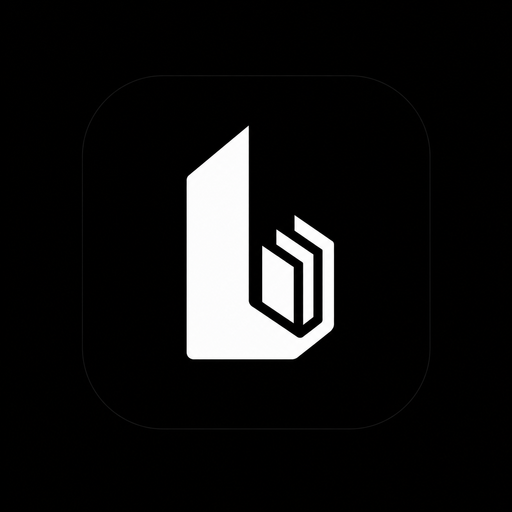

# Ludex

**Локальная библиотека игр «как в Steam» — для игр, которые уже лежат у вас на диске.**

Программа обходит указанные папки, сама находит игры, определяет названия и подтягивает обложки.
Без аккаунтов, без лаунчера, без облака — только ваши файлы и красивый интерфейс.

[](#установка)
[](#linux)
[](#macos)
[](#сборка-из-исходников)
[](https://avaloniaui.net)
[](CHANGELOG.md)
[](LICENSE)
[](https://ludex-one.vercel.app)

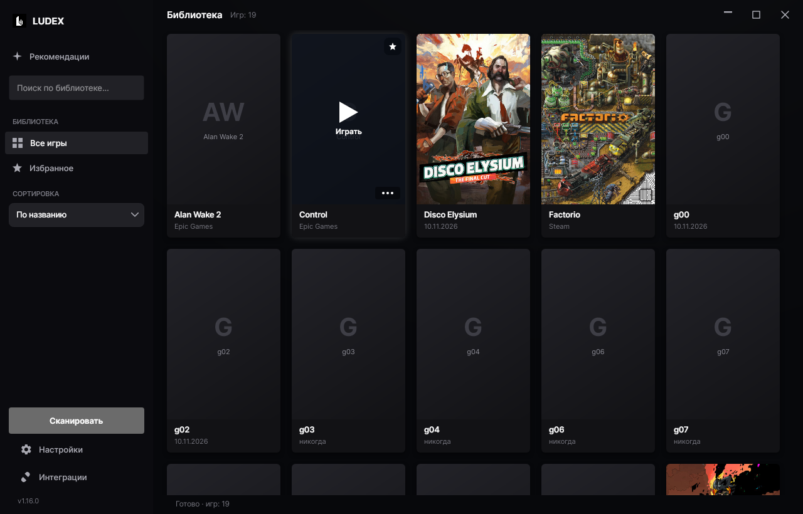

</div>

---

## Возможности

- **Автопоиск игр.** Указываете папку (или целый диск) → Ludex находит `.exe`, отбрасывает
  установщики и `vcredist`, вытаскивает настоящий файл запуска и чистит название от
  `[FitGirl Repack]`, `v1.6.8`, `_RUNE`, `MULTi12` и прочего мусора.
- **Обложки сами.** Поиск в каталоге Steam без ключей и регистрации; опционально — ключ
  SteamGridDB для портретных обложек и артов сообщества. Своя картинка с диска тоже подойдёт.
- **Запуск в один клик.** Клик по обложке — игра запускается (можно «от админа»),
  клик по подписи — панель игры с папкой, размером и статистикой запусков.
- **Поиск, сортировка, избранное.** По названию / дате добавления / последнему запуску,
  фильтр «★ Избранное», поиск по названию, папке и названию из Steam.
- **Кастомизация.** Тёмная и светлая темы, любой акцентный цвет (квадрат
  «насыщенность/яркость» + полоса оттенков + R/G/B), полупрозрачные стеклянные панели
  и обои на фон по ссылке — обычная картинка или GIF (анимированный).
- **Каталог одиночных игр.** Вкладка рекомендаций: больше тысячи игр, в которые можно
  играть без онлайна — экшены, приключения, инди, RPG, стратегии, симуляторы, казуальные,
  гонки, спорт и ранний доступ. Сетевые шутеры и MMO, бесплатные лайв-сервисы и программы
  вроде прицелов в подборку не попадают: каталог собирается из поиска магазина по фильтру
  «есть одиночная игра» и кэшируется на 3 дня.
- **Карточка игры.** Обложка, название, разработчик и издатель, жанры, короткое описание
  и кнопка **«Найти в браузере»** — открывает в браузере по умолчанию поиск по запросу
  «название игры» скачать (движок — Google, Яндекс или DuckDuckGo, выбирается в настройках).
  Цен и ссылок на сторонние раздачи в приложении нет.
- **Удаление с компьютера.** Из меню карточки: сначала запускается найденный деинсталлятор,
  если его нет — папка игры удаляется целиком (с подтверждением и защитой от опасных путей).
- **Русский и английский** интерфейс.
- **Портативно.** Один `.exe`, .NET ставить не нужно. Работает и как установщик без прав
  администратора (per-user install).

## Скриншоты

| Каталог одиночных игр | Жанры каталога |
|---|---|
| 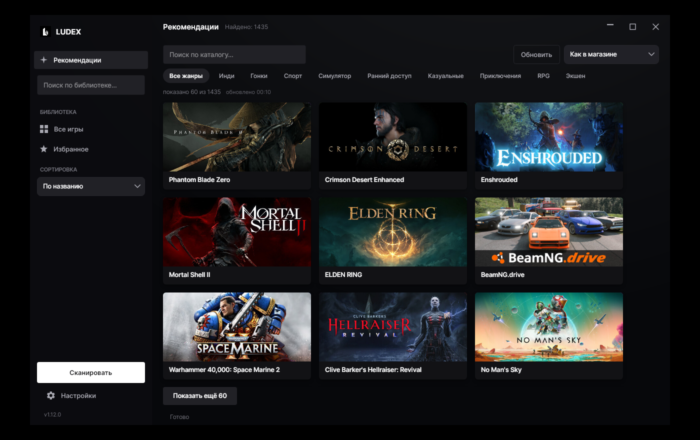 | 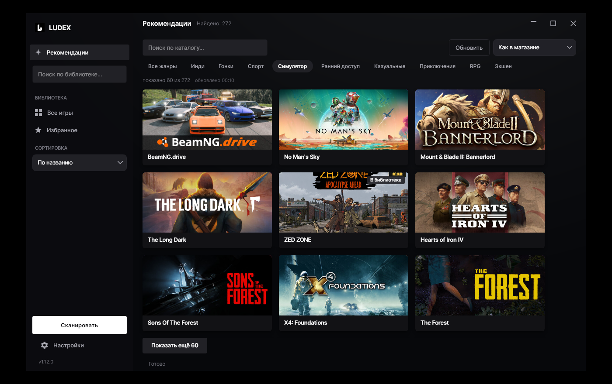 |

| Карточка игры: описание и «Найти в браузере» |
|---|
| 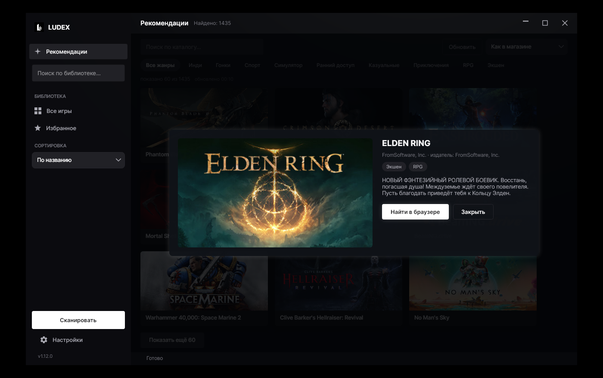 |

| Панель игры | Наведение на карточку |
|---|---|
| 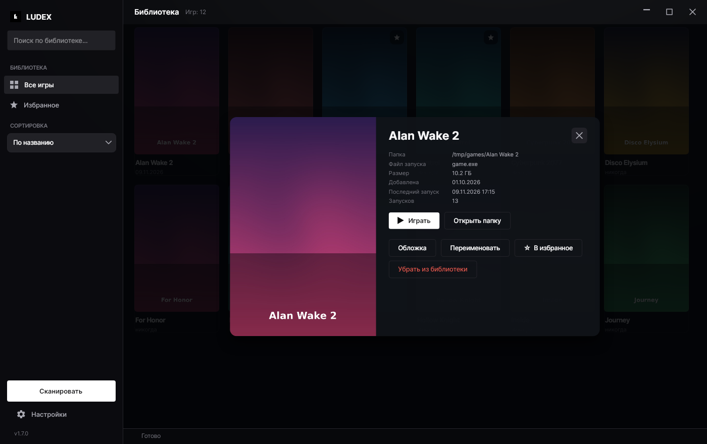 | 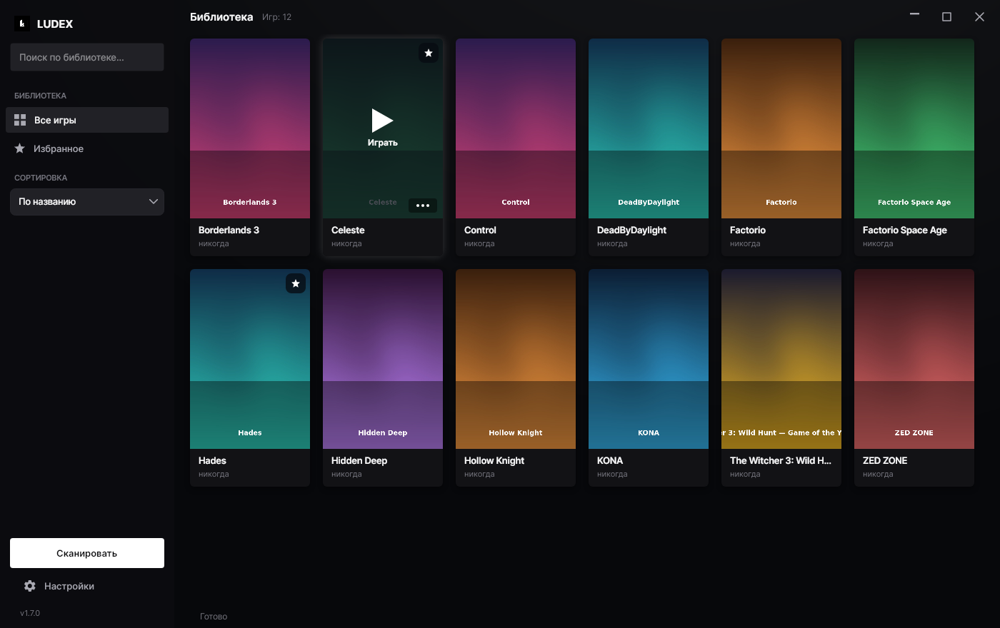 |

| Сортировка (свой дропдаун) | Окно запуска |
|---|---|
| 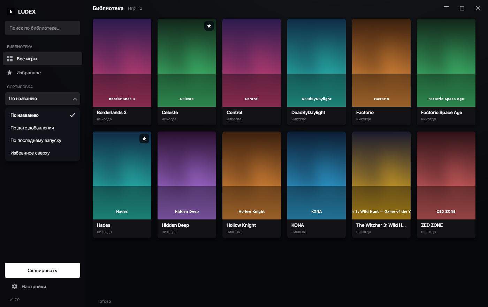 | 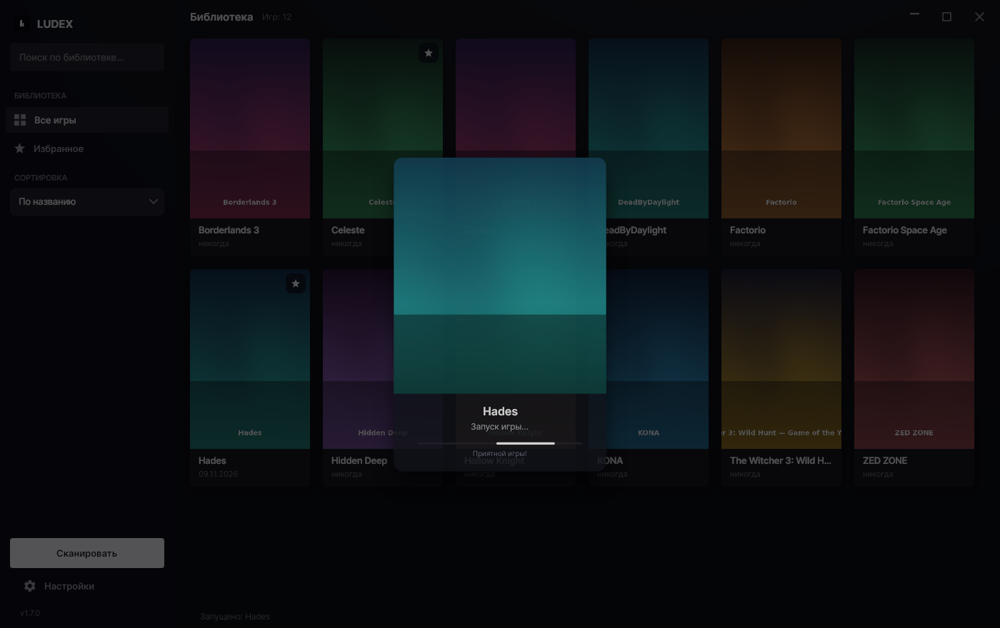 |

| Кастомизация | Светлая тема |
|---|---|
| 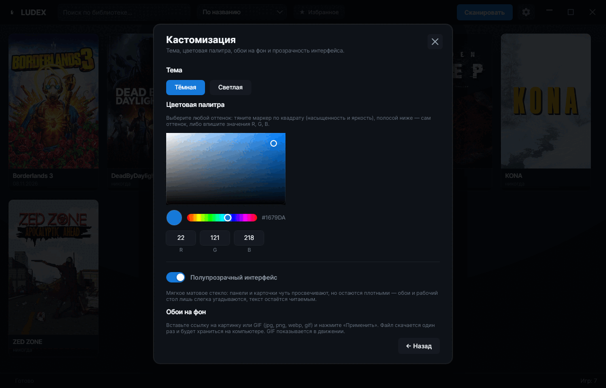 | 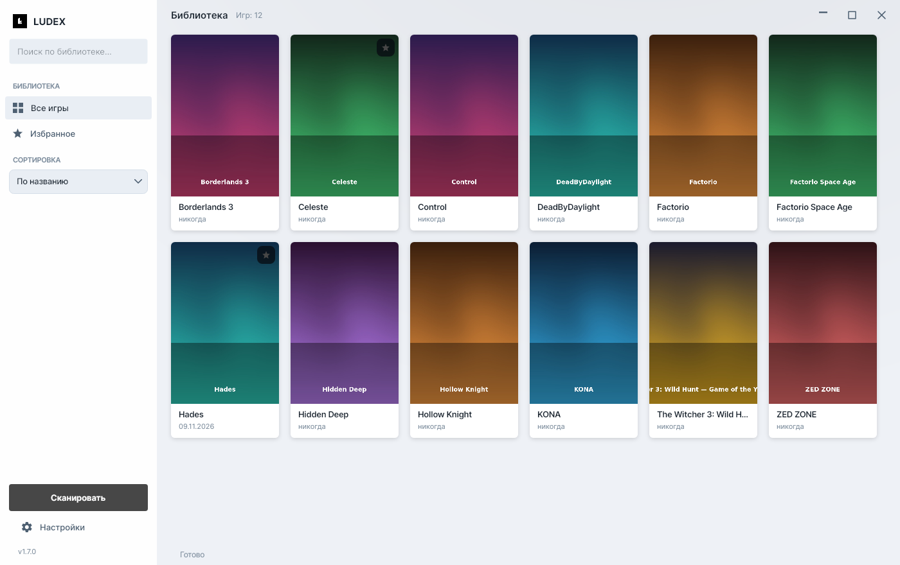 |

| Настройки | Обои на фоне |
|---|---|
| 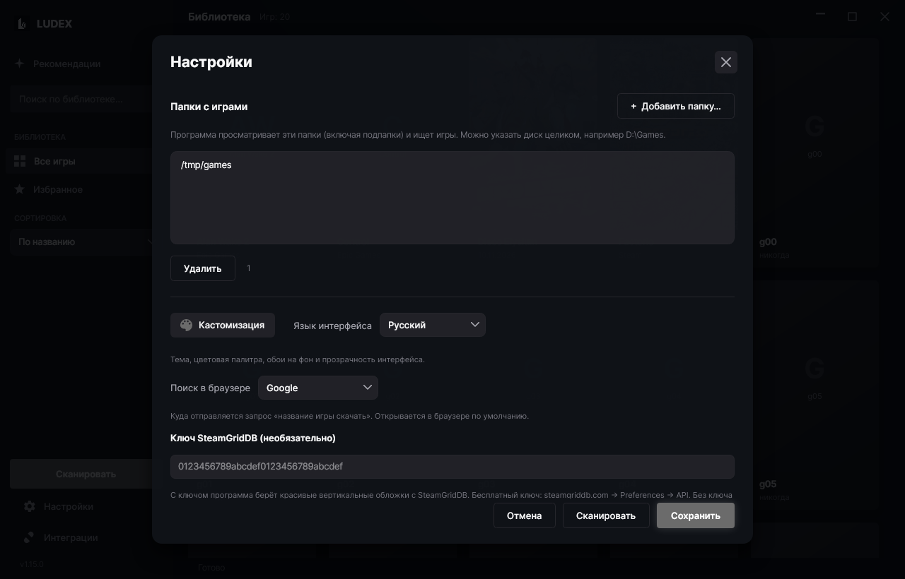 | 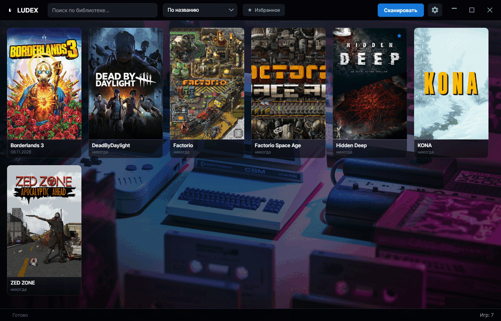 |

## Сайт

Лендинг проекта (тот же текст, скриншоты и кнопки скачивания) — **[ludex-one.vercel.app](https://ludex-one.vercel.app)**
(EN: [ludex-one.vercel.app/?lang=en](https://ludex-one.vercel.app/?lang=en)). Исходники сайта — папка [`site/`](site),
деплой автоматический на Vercel при каждом пуше в `main`.

На сайте работает счётчик скачиваний из двух источников:

- **GitHub** — `download_count` файлов релиза через [`site/api/downloads.js`](site/api/downloads.js),
  кэш на edge 10 минут (чтобы не упираться в лимит 60 запросов/час);
- **клики по кнопкам на самом сайте** — [`site/api/go.js`](site/api/go.js) считает переход в
  Upstash Redis и сразу отдаёт 302 на файл свежего релиза (ссылка запоминается в Redis, поэтому
  кнопки не зависят от версии, вписанной в разметку); читает счётчики
  [`site/api/clicks.js`](site/api/clicks.js) с кэшем 30 секунд.

На странице это выглядит как `↓ 128 скачиваний на GitHub · 34 клика с сайта`, а на каждой кнопке —
клики по конкретному файлу. Redis необязателен: без переменных окружения (или при сбое) сайт
показывает только статистику GitHub, а если и её не удалось получить — счётчик просто скрыт,
страница работает как обычно.

## Установка

Одно и то же приложение собирается под три системы. Все файлы — на странице
[Releases](https://github.com/dosherrk/ludex/releases), на сайте проекта кнопки подставляются
под вашу систему автоматически.

### Windows 10/11 (x64)

**Вариант 1 — установщик (рекомендуется).** `Ludex-Setup-1.5.0.exe` → выберите язык → «Далее».
Ставится в `%LOCALAPPDATA%\Programs\Ludex` (запрос администратора не появляется), создаёт ярлыки
на рабочем столе и в меню «Пуск», добавляет запись в «Установку и удаление программ» и деинсталлятор.

**Вариант 2 — портативно.** `Ludex-1.5.0-portable.exe` — запускайте откуда угодно, с флешки или из папки.
Настройки и библиотека хранятся в `%LOCALAPPDATA%\Ludex`.

> Файл не подписан сертификатом: SmartScreen при первом запуске может сказать
> «Windows защитила ваш компьютер» → «Подробнее» → «Выполнить в любом случае».
> Антивирусы иногда ругаются на любые self-contained .NET-приложения — это ложное срабатывание.

**Удаление.** «Параметры → Приложения → Установленные приложения → Ludex → Удалить».
Программа спросит, стирать ли настройки и кэш обложек. **Файлы самих игр не удаляются никогда.**

### Linux (x64) <a id="linux"></a>

**Пакет `.deb`** (Debian, Ubuntu, Mint, Pop!_OS и производные):

```bash
sudo apt install ./Ludex-1.5.0-linux-x64.deb
```

Появится ярлык в меню приложений, `ludex` — в `PATH`; файлы ставятся в `/opt/ludex`.
Удаление — `sudo apt remove ludex` (данные в `~/.local/share/Ludex` остаются).

**Портативный архив** `Ludex-1.5.0-linux-x64.tar.gz` — для любой системы с glibc 2.31+
(Fedora, Arch, openSUSE и т.д.):

```bash
mkdir -p ~/Applications/Ludex && tar -xzf Ludex-1.5.0-linux-x64.tar.gz -C ~/Applications/Ludex
~/Applications/Ludex/Ludex
```

Внутри архива: сам бинарник, `ludex.desktop` для меню и `КАК-ЗАПУСТИТЬ.txt`.
Нужны библиотеки интерфейса: libX11, libXrandr, libXi, libXcursor, libXext, libXrender,
libICE, libSM, libGL, libfontconfig, libfreetype, libxkbcommon; под Wayland работает через XWayland.

### macOS 11+ (Apple Silicon и Intel) <a id="macos"></a>

`Ludex-1.5.0-macos-arm64.dmg` — для Apple Silicon (M1–M4), `Ludex-1.5.0-macos-x64.dmg` — для Intel.
Откройте `.dmg`, перетащите Ludex в `Applications`. Рядом в релизе лежат те же сборки в `.zip`
(`Ludex-1.5.0-macos-arm64.zip` / `-x64.zip`) — если удобнее архив (его надо просто распаковать).

Приложение не подписано сертификатом Apple, поэтому первый запуск — правый клик по `Ludex.app`
→ **«Открыть»** → **«Открыть»** (или в Терминале: `xattr -dr com.apple.quarantine /Applications/Ludex.app`).

Данные хранятся в `~/Library/Application Support/Ludex`.

| Что | Windows | Linux | macOS |
|---|---|---|---|
| Поиск игр | `*.exe` | AppImage, нативные бинарники, `.sh` | `.app`-бандлы |
| Запуск в один клик | да | да | да |
| Обложки, темы, обои, поиск | да | да | да |
| Автозапуск с системой | да (реестр) | нет | нет |
| «Запуск от администратора» | да (UAC) | нет | нет |

## Первый запуск

1. Шестерёнка ⚙ справа сверху → **Папки с играми** → «+ Добавить папку…»
   (можно несколько папок или целый диск `D:\Games`).
2. **Сохранить** → **Сканировать**. Обложки подтянутся из Steam автоматически (нужен интернет).
3. Клик по обложке — запуск, клик по подписи — панель игры. Правый клик — то же меню.
4. Настройки → **Кастомизация**: тема, акцентный цвет, прозрачность, обои.

## Обновления

Ludex сам проверяет, не вышла ли новая версия, и обновляется без похода на сайт.

- Проверка идёт при запуске (Настройки → **Проверять обновления при запуске**) и по кнопке
  **Проверить обновления сейчас** там же.
- Источник — последний релиз [GitHub](https://github.com/dosherrk/ludex/releases); файл
  выбирается под систему и архитектуру: `Ludex-Setup-*.exe`, `Ludex-*-portable.exe`,
  `Ludex-*-macos-arm64.zip|dmg`, `Ludex-*-macos-x64.zip|dmg`, `Ludex-*-linux-x64.tar.gz`.
- Скачанное сверяется с `sha256` из метаданных релиза, прогресс виден в окне. Затем
  приложение закрывается, подменяет свои файлы и запускается заново — уже новой версией.
- Windows ставит установщик в тихом режиме (`/S`) или заменяет портативный `.exe`
  (из `Program Files` — с запросом UAC). macOS заменяет `Ludex.app` (при необходимости
  через пароль администратора). Linux распаковывает архив и подменяет бинарник
  (`pkexec`, если папка принадлежит root; при установке из `.deb` без `pkexec`
  предложит обновиться вручную).
- Проверить руками из консоли: `Ludex --version`, `Ludex --update-check`,
  `Ludex --update-apply`. Для тестов адрес фида подменяется переменной
  `LUDEX_UPDATE_FEED`.

## Что считается игрой

Сканер считает папку игрой, если внутри (или в подпапке) есть «правдоподобный» исполняемый файл:
в Windows — `*.exe`, в Linux — AppImage, нативный бинарник или `.sh`-обёртка с битом выполнения
(библиотеки `.so` и ярлыки `.desktop` отбрасываются), в macOS — `.app`-бандл (он берётся целиком,
внутрь не заходим).

- **Игнорируются:** `unins*`, `setup`, `install*`, `vcredist`, `dxsetup`, `dotnetfx`,
  `UnityCrashHandler`, `crashreport`, `7za`, `ffmpeg`, `python*`, `update*` и подобные.
- **Понижается приоритет:** `config`, `settings`, `launcher`, `benchmark`, `server`, `editor`.
- Из нескольких кандидатов выбирается самый крупный файл + совпадение имени с папкой
  (из `Launcher.exe` и `RDR2.exe` выберется второе).
- Служебные папки (`_CommonRedist`, `DirectX`, `vcredist`, `Support`, `soundtrack`, `Saves`,
  скрытые и системные) не просматриваются.
- Если `.exe` лежит во вложенной служебной папке (`MyGame\bin\x64\MyGame.exe`), игрой считается
  корневая папка, и название берётся из неё.
- Репаки вида `Portal 2 [FitGirl Repack]\setup.exe` + `Game\portal2.exe` тоже распознаются.

Свой список игнорируемых имён можно дописать в настройках. Ручные правки (переименование,
выбранная обложка) повторное сканирование **не перезаписывает**.

## Где хранятся данные

`%LOCALAPPDATA%\Ludex`

| Файл | Что это |
|---|---|
| `library.json` | база библиотеки: названия, пути, избранное, статистика запусков |
| `settings.json` | настройки: папки, тема, палитра, прозрачность, язык, ключ SteamGridDB |
| `covers\` | кэш скачанных обложек |
| `background.*` | скачанные обои, если вы их ставили |
| `log.txt` | журнал — пригодится, если что-то пошло не так |

Кнопка «Открыть папку данных» есть в настройках.

> **Переезд со старого имени.** До версии 1.4.0 приложение называлось GameVault.
> При первом запуске Ludex папка `%LOCALAPPDATA%\GameVault` копируется в `%LOCALAPPDATA%\Ludex`,
> старые ярлыки и запись автозапуска убираются. Оригинальная папка остаётся нетронутой.

## Сборка из исходников

Нужны [.NET 8 SDK](https://dotnet.microsoft.com/download) и [NSIS 3](https://nsis.sourceforge.io/)
(для установщика).

```bash
# портативный single-file exe под Windows x64 (кросс-сборка работает с Linux/macOS)
dotnet publish src/Ludex -c Release -r win-x64 --self-contained true \
  -p:PublishSingleFile=true -p:IncludeNativeLibrariesForSelfExtract=true \
  -p:EnableCompressionInSingleFile=true -p:PublishReadyToRun=false -p:DebugType=none \
  -o release/app

# установщик (NSIS) → release/Ludex-Setup-<версия>.exe
cd installer && makensis Ludex.nsi
```

Готовые скрипты: `./build.sh` (Linux/macOS) и `build_windows.bat` (Windows).

### Как собирается macOS DMG

`build.sh mac` делает `Ludex.app` и кладёт его в `.zip`. DMG-образ собирается
отдельным скриптом — на Linux, без macOS и без подписи Apple:

```bash
./tools/make-dmg.sh release/macos-arm64/Ludex.app Ludex-1.5.0-macos-arm64.dmg "Ludex 1.5.0" 90
```

Как собрать эти утилиты на Ubuntu/Debian (проверено на 24.04, gcc 13, OpenSSL 3):

```bash
# 1. mkfs.hfsplus (hfsprogs): Ubuntu его больше не пакетирует, берём исходник из архива
curl -LO http://archive.ubuntu.com/ubuntu/pool/universe/h/hfsprogs/hfsprogs_332.25.orig.tar.gz
git clone --depth 1 https://github.com/rbrito/pkg-hfsprogs.git hfsprogs && cd hfsprogs
for p in debian/patches/*.patch; do patch -p1 -s < "$p"; done      # патчи Debian = сборка на Linux
mkdir -p /tmp/stub/sys && : > /tmp/stub/sys/sysctl.h                 # на Linux этого заголовка нет
gcc -DDEBUG_BUILD=0 -D_FILE_OFFSET_BITS=64 -D LINUX=1 -D BSD=1 \
    -I/tmp/stub -Iinclude -I/usr/include/x86_64-linux-gnu -O2 -w \
    newfs_hfs.tproj/newfs_hfs.c newfs_hfs.tproj/makehfs.c newfs_hfs.tproj/hfs_endian.c \
    -lbsd -lcrypto -o /tmp/newfs_hfs                                     # нужен libbsd-dev

# 2. hfsplus и dmg из libdmg-hfsplus — под OpenSSL 3 правится тип HMAC_CTX
git clone --depth 1 https://github.com/planetbeing/libdmg-hfsplus.git && cd libdmg-hfsplus
#   includes/dmg/filevault.h:  HMAC_CTX hmacCTX      →  HMAC_CTX *hmacCTX
#   dmg/filevault.c:          HMAC_CTX_init(&x)     →  x = HMAC_CTX_new()
#                             HMAC_CTX_cleanup(&x)  →  HMAC_CTX_free(x); x = NULL
#                             HMAC_*(&(info->hmacCTX), ...) → HMAC_*(info->hmacCTX, ...)
cmake -DCMAKE_BUILD_TYPE=Release . && make -j4
export NEWFS_HFS=/tmp/newfs_hfs HFSPLUS=$PWD/hfs/hfsplus DMG=$PWD/dmg/dmg
```

Скрипту нужны три утилиты, собранные из исходников (в репозиторий они не входят):
`newfs_hfs` (mkfs.hfsplus из hfsprogs), `hfsplus` и `dmg` из libdmg-hfsplus —
пути передаются через переменные `NEWFS_HFS`, `HFSPLUS`, `DMG`. Внутрь тома кладутся
`Ludex.app`, `INSTALL.txt` и симлинк `Applications → /Applications`, исполняемым
файлам возвращается бит `+x`, после чего HFS+ образ сжимается в UDIF (zlib).

### Структура проекта

```
src/Ludex/
  Program.cs, App.cs            — точка входа, инициализация темы
  Models.cs                     — модели игры и настроек
  Loc.cs                        — локализация RU/EN
  AppPaths.cs                   — пути к данным, лог, перенос данных с GameVault
  Services/
    Scanner.cs                  — обход папок, эвристики выбора .exe, очистка названий
    Artwork.cs                  — Steam / SteamGridDB, скачивание обложек
    Storage.cs                  — library.json / settings.json
    Shell.cs                    — запуск игр, открытие папок
    Backgrounds.cs              — загрузка обоев, в т.ч. анимированных GIF
    Autostart.cs                — автозапуск вместе с Windows
    Platform.cs                 — различия платформ: поиск и запуск игр, права
  UI/
    MainWindow.cs               — сетка библиотеки, панель игры, окно запуска, обои, сканирование
    SettingsPanel.cs            — настройки (встроенная панель внутри главного окна)
    CustomizePanel.cs           — тема, палитра, прозрачность, обои
    ColorPicker.cs              — выбор цвета: квадрат HSV, полоса оттенков, поля R/G/B
    Dropdown.cs, Toggle.cs      — свои выпадающий список и переключатель
    Menu.cs, OverlayPanel.cs    — контекстное меню и панели поверх окна (без окон ОС)
    ProgressStrip.cs            — индикатор сканирования с бегущим свечением
    Skin.cs                     — палитры тёмной/светлой темы, акцент, стеклянный режим
    CoverWindow.cs              — ручной выбор обложки
    Dialogs.cs, Ui.cs           — диалоги, контролы, иконки, анимации
installer/Ludex.nsi             — установщик + деинсталлятор (NSIS)
site/                           — лендинг для Vercel (index.html, styles.css, app.js, img/)
assets/logo-ludex.png           — исходник логотипа (из него собраны app.ico и Assets/icon.png)
```

## Примечания

- Клик по обложке запускает игру (как в Steam), клик по названию открывает панель игры.
- Программа не поддерживает ярлыки `.url` / `.lnk`, эмуляторы и игры из других лаунчеров
  (Steam/Epic/GOG) — только реальные папки с `.exe`.
- Некоторым играм нужны права администратора (античит/DRM) — используйте «Играть от админа».
- Автозапуск с системой, «запуск от администратора» и акриловое размытие панелей —
  только Windows; в Linux и macOS этих пунктов в интерфейсе нет.
- Сборки для macOS и Linux не подписаны (Apple Developer ID / ключи для deb нет),
  поэтому Gatekeeper и SmartScreen могут предупреждать при первом запуске.
- Обои скачиваются по прямой ссылке на файл; ссылки Pinterest (`pinterest.com/pin/…`,
  `pin.it/…`, `i.pinimg.com/…`) тоже поддерживаются — программа сама достаёт адрес картинки
  в исходном размере.
- Обложки загружаются из публичных каталогов Steam / SteamGridDB и принадлежат их правообладателям.

## Нашли баг?

Откройте issue — для каждой платформы есть отдельная форма, она сама спросит нужное:

- **[Ошибка в версии для macOS](https://github.com/dosherrk/ludex/issues/new?template=bug-macos.yml)** —
  чип, версия macOS, способ установки, вывод из Терминала и `~/Library/Application Support/Ludex/log.txt`.
- **[Ошибка в версии для Linux](https://github.com/dosherrk/ludex/issues/new?template=bug-linux.yml)** —
  дистрибутив, `.deb` или `.tar.gz`, X11/Wayland, `ldd` и `~/.local/share/Ludex/log.txt`.

Для Windows и всего остального — [пустая форма](https://github.com/dosherrk/ludex/issues/new).
Перед отправкой убедитесь, что версия — последняя из [релиза](https://github.com/dosherrk/ludex/releases/latest).

## Лицензия

[MIT](LICENSE). Сторонние библиотеки: [Avalonia UI](https://avaloniaui.net) (MIT),
Avalonia.Labs.Gif (MIT).

<div align="center">
<sub>Логотип и иконки — часть проекта Ludex.</sub>
</div>
