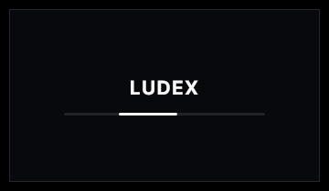
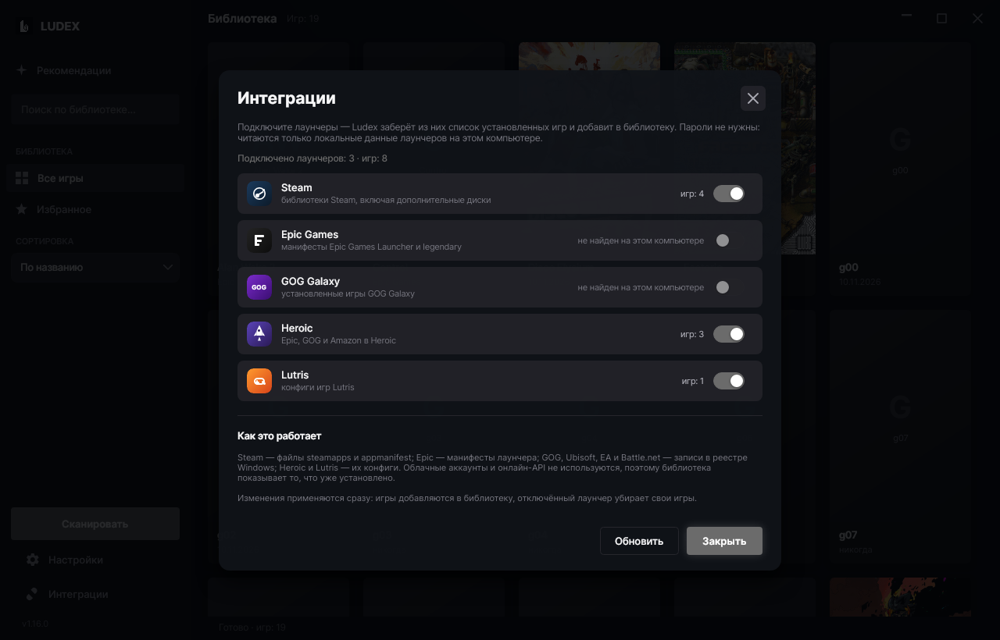

<div align="center">


# Ludex

**Локальная библиотека игр «как в Steam» — для игр, которые уже лежат у вас на диске.**

Программа обходит указанные папки, сама находит игры, определяет названия и подтягивает обложки.
Без аккаунтов, без лаунчера, без облака — только ваши файлы и красивый интерфейс.

[](#установка)
[](#linux)
[](#сборка-из-исходников)
[](https://avaloniaui.net)
[](CHANGELOG.md)
[](LICENSE)
[](https://ludex-one.vercel.app)


</div>

---

## Поддержать автора

Ludex бесплатный: без аккаунтов, подписки и рекламы. Если приложение сэкономило вам время,
можно сказать спасибо через **DonationAlerts** — разово или подпиской, картой или СБП:

**[donationalerts.com/r/c04hbiu](https://www.donationalerts.com/r/c04hbiu)** — страница «C04HbIU»

[](https://www.donationalerts.com/r/c04hbiu)

## Возможности

- **Автопоиск игр.** Указываете папку (или целый диск) → Ludex находит `.exe`, отбрасывает
  установщики и `vcredist`, вытаскивает настоящий файл запуска и чистит название от
  `[FitGirl Repack]`, `v1.6.8`, `_RUNE`, `MULTi12` и прочего мусора.
- **Обложки сами.** Поиск в каталоге Steam без ключей и регистрации; опционально — ключ
  SteamGridDB для портретных обложек и артов сообщества. Своя картинка с диска тоже подойдёт.
- **Запуск в один клик.** Клик по обложке — игра запускается (можно «от админа»),
  клик по подписи — панель игры с папкой, размером и статистикой запусков.
- **Поиск, сортировка, избранное.** По названию / дате добавления / последнему запуску,
  фильтр «★ Избранное», поиск по названию, папке и названию из Steam.
- **Кастомизация.** Тёмная и светлая темы, любой акцентный цвет (квадрат
  «насыщенность/яркость» + полоса оттенков + R/G/B), полупрозрачные стеклянные панели
  и обои на фон по ссылке — обычная картинка или GIF (анимированный).
- **Каталог одиночных игр.** Вкладка «Каталог»: больше тысячи игр, в которые можно
  играть без онлайна — экшены, приключения, инди, RPG, стратегии, симуляторы, казуальные,
  гонки, спорт и ранний доступ. Сетевые шутеры и MMO, бесплатные лайв-сервисы и программы
  вроде прицелов в подборку не попадают: каталог собирается из поиска магазина по фильтру
  «есть одиночная игра» и кэшируется на 3 дня.
- **Быстрый старт.** При запуске показывается экран загрузки: под ним собираются каталог
  и ваша библиотека, поэтому «Рекомендации» открываются сразу, уже с обложками. Кэш каталога
  живёт 3 дня, устаревший показывается мгновенно и обновляется в фоне.
- **Карточка игры.** Обложка, название, разработчик и издатель, жанры, короткое описание
  и кнопка **«Найти в браузере»** — открывает в браузере по умолчанию поиск по запросу
  «название игры» скачать (движок — Google, Яндекс или DuckDuckGo, выбирается в настройках).
  Цен и ссылок на сторонние раздачи в приложении нет.
- **Удаление с компьютера.** Из меню карточки: сначала запускается найденный деинсталлятор,
  если его нет — папка игры удаляется целиком (с подтверждением и защитой от опасных путей).
- **Русский и английский** интерфейс.
- **Портативно.** Один `.exe`, .NET ставить не нужно. Работает и как установщик без прав
  администратора (per-user install).

## Скриншоты

| Экран загрузки (отдельное окно) | Библиотека |
|---|---|
|  |  |

| Панель игры | Каталог |
|---|---|
|  |  |

| Интеграции с лаунчерами | Настройки |
|---|---|
|  |  |

| Кастомизация | Светлая тема |
|---|---|
|  |  |

## Сайт

Лендинг проекта (тот же текст, скриншоты и кнопки скачивания) — **[ludex-one.vercel.app](https://ludex-one.vercel.app)**
(EN: [ludex-one.vercel.app/?lang=en](https://ludex-one.vercel.app/?lang=en)). Исходники сайта — папка [`site/`](site),
деплой автоматический на Vercel при каждом пуше в `main`.

На сайте работает счётчик скачиваний из двух источников:

- **GitHub** — `download_count` файлов релиза через [`site/api/downloads.js`](site/api/downloads.js),
  кэш на edge 10 минут (чтобы не упираться в лимит 60 запросов/час);
- **клики по кнопкам на самом сайте** — [`site/api/go.js`](site/api/go.js) считает переход в
  Upstash Redis и сразу отдаёт 302 на файл свежего релиза (ссылка запоминается в Redis, поэтому
  кнопки не зависят от версии, вписанной в разметку); читает счётчики
  [`site/api/clicks.js`](site/api/clicks.js) с кэшем 30 секунд.

На странице это выглядит как `↓ 128 скачиваний на GitHub · 34 клика с сайта`, а на каждой кнопке —
клики по конкретному файлу. Redis необязателен: без переменных окружения (или при сбое) сайт
показывает только статистику GitHub, а если и её не удалось получить — счётчик просто скрыт,
страница работает как обычно.

## Установка

Одно и то же приложение собирается под три системы. Все файлы — на странице
[Releases](https://github.com/dosherrk/ludex/releases), на сайте проекта кнопки подставляются
под вашу систему автоматически.

### Windows 10/11 (x64)

**Вариант 1 — установщик (рекомендуется).** `Ludex-Setup-1.19.4.exe` → выберите язык → «Далее».
Ставится в `%LOCALAPPDATA%\Programs\Ludex` (запрос администратора не появляется), создаёт ярлыки
на рабочем столе и в меню «Пуск», добавляет запись в «Установку и удаление программ» и деинсталлятор.

**Вариант 2 — портативно.** `Ludex-1.19.4-windows.zip` — распакуйте папку целиком куда угодно
(флешка, `D:\Ludex`) и запускайте `Ludex.exe`. Настройки и библиотека хранятся в `%LOCALAPPDATA%\Ludex`.

> Файлы должны лежать вместе: `Ludex.exe` не работает без `Ludex.dll` и папки `runtimes` рядом.
> Поэтому один exe не перетаскивают на рабочий стол — делают ярлык на него. С 1.19.4 приложение
> поставляется набором файлов, а не одним большим exe: так запуск заметно быстрее, потому что
> не нужно распаковывать встроенный рантайм во временную папку при каждом старте.

> Файл не подписан сертификатом: SmartScreen при первом запуске может сказать
> «Windows защитила ваш компьютер» → «Подробнее» → «Выполнить в любом случае».
> Антивирусы иногда ругаются на любые self-contained .NET-приложения — это ложное срабатывание.

**Удаление.** «Параметры → Приложения → Установленные приложения → Ludex → Удалить».
Программа спросит, стирать ли настройки и кэш обложек. **Файлы самих игр не удаляются никогда.**

### Linux (x64) <a id="linux"></a>

**Пакет `.deb`** (Debian, Ubuntu, Mint, Pop!_OS и производные):

```bash
sudo apt install ./Ludex-1.19.4-linux-x64.deb
```

Появится ярлык в меню приложений, `ludex` — в `PATH`; файлы ставятся в `/opt/ludex`.
Удаление — `sudo apt remove ludex` (данные в `~/.local/share/Ludex` остаются).

**Портативный архив** `Ludex-1.19.4-linux-x64.tar.gz` — для любой системы с glibc 2.31+
(Fedora, Arch, openSUSE и т.д.):

```bash
mkdir -p ~/Applications && tar -xzf Ludex-1.19.4-linux-x64.tar.gz -C ~/Applications
~/Applications/Ludex/Ludex
```

Внутри архива папка `Ludex` со всеми файлами приложения (бинарник, библиотеки рантайма),
`ludex.desktop` для меню и `КАК-ЗАПУСТИТЬ.txt`. Файлы должны оставаться вместе.
Нужны библиотеки интерфейса: libX11, libXrandr, libXi, libXcursor, libXext, libXrender,
libICE, libSM, libGL, libfontconfig, libfreetype, libxkbcommon; под Wayland работает через XWayland.

| Что | Windows | Linux |
|---|---|---|
| Поиск игр | `*.exe` | AppImage, нативные бинарники, `.sh` |
| Запуск в один клик | да | да |
| Обложки, темы, обои, поиск | да | да |
| Автозапуск с системой | да (реестр) | нет |
| «Запуск от администратора» | да (UAC) | нет |

### Почему в поставке много файлов

Приложение публикуется как набор файлов (`PublishSingleFile=false`): `Ludex`/`Ludex.exe` плюс
сборки .NET и Avalonia рядом. Так запуск быстрее — не нужно распаковывать встроенный рантайм
во временную папку при каждом старте (замеры: окно за ~0.5 с вместо ~1.5 с).

Обрезка неиспользуемого кода (`PublishTrimmed` в режиме `partial`) уменьшила поставку с 215
файлов / 92 МБ до **92 файлов / 42 МБ** — лишние сборки фреймворка в архив больше не попадают.

Собрать всё в «несколько dll» нельзя без риска: .NET не поддерживает слияние сборок, а
сторонние утилиты вроде ILRepack ломают ресурсные адреса Avalonia (`avares://…` — по имени
сборки грузятся темы и картинки). Раскладывать сборки по подпапкам тоже нельзя: загрузчик
ищет их рядом с исполняемым файлом согласно `Ludex.deps.json`. Поэтому «аккуратность» решена
на уровне архива: пользователь получает **одну папку** `Ludex-<версия>`, внутри — файлы
приложения и `КАК-ЗАПУСТИТЬ.txt`, а на Linux — ещё ярлык и иконку.

### Откуда берётся каталог игр

Обходить магазин на компьютере пользователя — долго и невежливо (это ~2000 запросов и
20 минут). Поэтому каталог собирается один раз в сутки в CI:

- workflow `.github/workflows/catalog.yml` запускает `tools/build-catalog.py` по расписанию;
- скрипт обходит поиск Steam целиком (все одиночные игры, `category1=998&category2=2`),
  вычитает бесплатные сетевые поделки и MMO, жанры берёт из тегов прямо в выдаче;
- для 20 000 самых заметных игр добавляются **описание, разработчик, издатель и год** —
  пакетным вызовом `IStoreBrowseService/GetItems` (200 игр за запрос), так что карточка
  открывается сразу и работает без сети;
- результат — два файла на [GitHub Pages](https://dosherrk.github.io/ludex/catalog.meta.json):
  `catalog.ru.json.gz` (~5 МБ) и `catalog.en.json.gz` (~4 МБ), плюс `catalog.json.gz` —
  копия русской для версий до 1.19;
- приложение скачивает файл своего языка при первом запуске и раз в сутки, кладёт в локальный
  кэш и фильтрует по своим правилам (без онлайна, без программ). Если файла нет — берёт общий
  `catalog.json.gz`, а если и того нет — как раньше, обходит магазин само.

Собрать вручную:

```bash
# полный обход (~70 минут) + описания + русский файл
python3 tools/build-catalog.py --out catalog.ru.json.gz --details-top 20000 --base /tmp/base.json

# английская версия из того же обхода — минута
python3 tools/build-catalog.py --out catalog.en.json.gz --lang english --cc US \
    --details-top 20000 --base /tmp/base.json

python3 tools/build-catalog.py --limit-pages 5 --out /tmp/try.json.gz   # проба
```

## Первый запуск

1. Шестерёнка ⚙ справа сверху → **Папки с играми** → «+ Добавить папку…»
   (можно несколько папок или целый диск `D:\Games`).
2. **Сохранить** → **Сканировать**. Обложки подтянутся из Steam автоматически (нужен интернет).
3. Клик по обложке — запуск, клик по подписи — панель игры. Правый клик — то же меню.
4. Настройки → **Кастомизация**: тема, акцентный цвет, прозрачность, обои.

## Обновления

Ludex сам проверяет, не вышла ли новая версия, и обновляется без похода на сайт.

- Проверка идёт при запуске (Настройки → **Проверять обновления при запуске**) и по кнопке
  **Проверить обновления сейчас** там же.
- Источник — последний релиз [GitHub](https://github.com/dosherrk/ludex/releases); файл
  выбирается под систему и архитектуру: `Ludex-Setup-*.exe`, `Ludex-*-windows.zip`,
  `Ludex-*-linux-x64.tar.gz`.
- Скачанное сверяется с `sha256` из метаданных релиза, прогресс виден в окне. Затем
  приложение закрывается, подменяет свои файлы и запускается заново — уже новой версией.
- Windows ставит установщик в тихом режиме (`/S`) или распаковывает портативный архив
  и накрывает папку приложения новыми файлами (из `Program Files` — с запросом UAC).
  Linux распаковывает архив и заменяет файлы приложения
  (`pkexec`, если папка принадлежит root; при установке из `.deb` без `pkexec`
  предложит обновиться вручную).
- Проверить руками из консоли: `Ludex --version`, `Ludex --update-check`,
  `Ludex --update-apply`. Для тестов адрес фида подменяется переменной
  `LUDEX_UPDATE_FEED`.

## Что считается игрой

Сканер считает папку игрой, если внутри (или в подпапке) есть «правдоподобный» исполняемый файл:
в Windows — `*.exe`, в Linux — AppImage, нативный бинарник или `.sh`-обёртка с битом выполнения
(библиотеки `.so` и ярлыки `.desktop` отбрасываются).

- **Игнорируются:** `unins*`, `setup`, `install*`, `vcredist`, `dxsetup`, `dotnetfx`,
  `UnityCrashHandler`, `crashreport`, `7za`, `ffmpeg`, `python*`, `update*` и подобные.
- **Понижается приоритет:** `config`, `settings`, `launcher`, `benchmark`, `server`, `editor`.
- Из нескольких кандидатов выбирается самый крупный файл + совпадение имени с папкой
  (из `Launcher.exe` и `RDR2.exe` выберется второе).
- Служебные папки (`_CommonRedist`, `DirectX`, `vcredist`, `Support`, `soundtrack`, `Saves`,
  скрытые и системные) не просматриваются.
- Если `.exe` лежит во вложенной служебной папке (`MyGame\bin\x64\MyGame.exe`), игрой считается
  корневая папка, и название берётся из неё.
- Репаки вида `Portal 2 [FitGirl Repack]\setup.exe` + `Game\portal2.exe` тоже распознаются.

Свой список игнорируемых имён можно дописать в настройках. Ручные правки (переименование,
выбранная обложка) повторное сканирование **не перезаписывает**.

## Где хранятся данные

`%LOCALAPPDATA%\Ludex`

| Файл | Что это |
|---|---|
| `library.json` | база библиотеки: названия, пути, избранное, статистика запусков |
| `settings.json` | настройки: папки, тема, палитра, прозрачность, язык, ключ SteamGridDB |
| `covers\` | кэш скачанных обложек |
| `background.*` | скачанные обои, если вы их ставили |
| `log.txt` | журнал — пригодится, если что-то пошло не так |

Кнопка «Открыть папку данных» есть в настройках.

> **Переезд со старого имени.** До версии 1.4.0 приложение называлось GameVault.
> При первом запуске Ludex папка `%LOCALAPPDATA%\GameVault` копируется в `%LOCALAPPDATA%\Ludex`,
> старые ярлыки и запись автозапуска убираются. Оригинальная папка остаётся нетронутой.

## Сборка из исходников

Нужны [.NET 8 SDK](https://dotnet.microsoft.com/download) и [NSIS 3](https://nsis.sourceforge.io/)
(для установщика).

```bash
# портативный single-file exe под Windows x64 (кросс-сборка работает с Linux)
dotnet publish src/Ludex -c Release -r win-x64 --self-contained true \
  -p:PublishSingleFile=true -p:IncludeNativeLibrariesForSelfExtract=true \
  -p:EnableCompressionInSingleFile=true -p:PublishReadyToRun=false -p:DebugType=none \
  -o release/app

# установщик (NSIS) → release/Ludex-Setup-<версия>.exe
cd installer && makensis Ludex.nsi
```

Готовые скрипты: `./build.sh` (Linux) и `build_windows.bat` (Windows).

## Примечания

- Клик по обложке запускает игру (как в Steam), клик по названию открывает панель игры.
- Программа не поддерживает ярлыки `.url` / `.lnk`, эмуляторы и игры из других лаунчеров
  (Steam/Epic/GOG) — только реальные папки с `.exe`.
- Некоторым играм нужны права администратора (античит/DRM) — используйте «Играть от админа».
- Автозапуск с системой, «запуск от администратора» и акриловое размытие панелей —
  только Windows; в Linux этих пунктов в интерфейсе нет.
- Сборки для Linux не подписаны (ключей для deb нет), поэтому SmartScreen
  и предупреждения пакетного менеджера могут просить подтвердить первый запуск.
- Обои скачиваются по прямой ссылке на файл; ссылки Pinterest (`pinterest.com/pin/…`,
  `pin.it/…`, `i.pinimg.com/…`) тоже поддерживаются — программа сама достаёт адрес картинки
  в исходном размере.
- Обложки загружаются из публичных каталогов Steam / SteamGridDB и принадлежат их правообладателям.

## Нашли баг?

Откройте issue — для каждой платформы есть отдельная форма, она сама спросит нужное:

- **[Ошибка в версии для Linux](https://github.com/dosherrk/ludex/issues/new?template=bug-linux.yml)** —
  дистрибутив, `.deb` или `.tar.gz`, X11/Wayland, `ldd` и `~/.local/share/Ludex/log.txt`.

Для Windows и всего остального — [пустая форма](https://github.com/dosherrk/ludex/issues/new).
Перед отправкой убедитесь, что версия — последняя из [релиза](https://github.com/dosherrk/ludex/releases/latest).

## Лицензия

[MIT](LICENSE). Сторонние библиотеки: [Avalonia UI](https://avaloniaui.net) (MIT),
Avalonia.Labs.Gif (MIT).

<div align="center">
<sub>Логотип и иконки — часть проекта Ludex.</sub>
</div>
